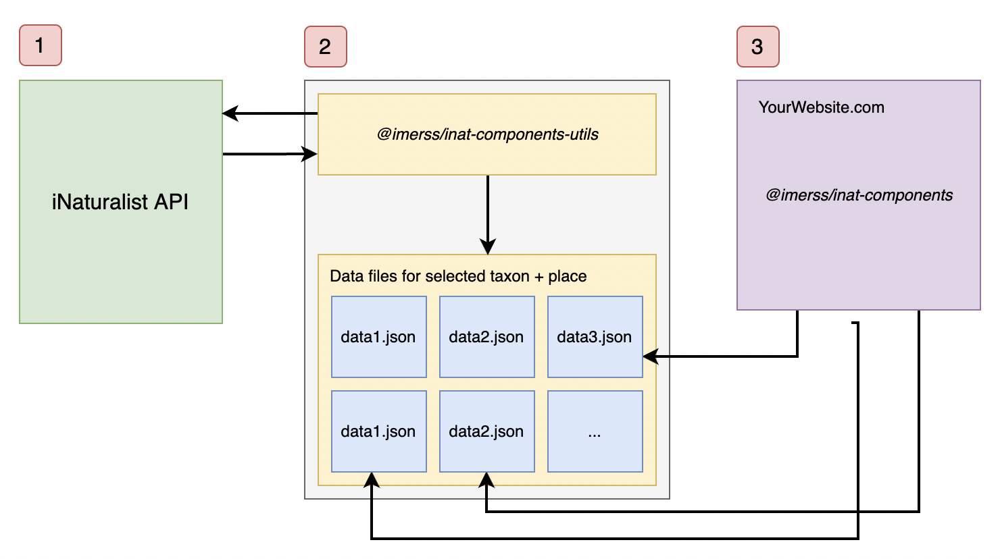

# inat-components

This repo contains some pre-built React components to display iNaturalist data on your own sites. The original goal was to
add an [interactive page to the BC Lepidoptera website](https://bcleps.weebly.com/inat.html) so visitors could 
see some high-level information about lepidoptera (butterflies and moths) spotted in British Columbia. But the code 
was written to allow it to be re-used by any website and for any taxon or place.

This repo stores both the components themselves (published to npm under `@imerss/inat-components`) and the backend
scripts to scrape iNat data and store it in JSON files for use by the front-end components (`@imerss/inat-components-utils`).
See below for an explanation of why that's necessary.

You have a choice with the front-end components to display any of four pieces of information:
- recent observations
- common taxa
- most favourited
- general summary (graph)

The main TaxonPanel component displays the information in tabbed format. Everything from text, labels and styles can be
customized, including which tabs appear.

### Demo

- Simple: https://imerss.github.io/inat-components/
- Live example: https://bcleps.weebly.com/inat.html


### How it works



1. iNaturalist stores all of the data about observations, taxonomy, observers and so on. They kindly provide a 
[public API](https://api.inaturalist.org/v1/docs/) (Application Programming Interface) to allow developers to request
data programmatically. The inat-components repo relies on that API to request the data that you need.
2. In between the iNat API and your own website is a script (`@imerss/inat-components-utils`) that does the job of calling
iNat and storing the data you want into separate data files. This code can run wherever you want - your own website 
is probably the most convenient. But wherever it is, it has to put the data files in a place that can be called by a
website (i.e. an http/https location).
3. The front-end code running on your website then makes requests to the data files. They are designed to be as small 
as possible and contain the minimal amount of data needed. This ensures the requests are as quick as possible so the 
user viewing your site doesn't have to wait. 

_Why the need for #2? Why not just call the iNat API from your own website?_ A few reasons: 
- First it's slow. The iNaturalist server has to do a lot of work on their end to retrieve the information for each API request. 
- Secondly, the response will contain a ton of information you don't need. 
- Lastly, iNaturalist limits the number of times you can make requests to their server per second, so they would be likely 
to shut down your access to their API.

### Installation

To use the components in your React code, just use npm, pnpm or yarn - whatever package manager you want. 

```
npm install @imerss/inat-components
pnpm add @imerss/inat-components
yarn add @imerss/inat-components
```

The components need React 18 or later, which your site supplies. If your site doesn't use React, use the
[standalone version](#standalone-version) instead, a single script which includes React.

### Features:

- Written in Typescript with typings for components and interfaces.
- Generic. Can display information for any taxon and any place, or for an iNaturalist project.
- Two choices of data source, set by `dataSource`:
    1. `url` - read data files generated in advance at a URL of your own (recommended - this lib contains a tool,
       `@imerss/inat-components-utils`, to generate them for you)
    2. `autoLoad` - request the data from the iNaturalist API directly (not recommended, but handy for local
       development)
- Default styling provided, but you can override anything you want.
- Option to replace the components which render the labels of the results, the loading indicator and the message
  shown when the results could not be loaded (`components.label`, `components.loader` and `components.error`).


### Available components

We'll go into details about each of these components below, but here's what's available.

`<TaxonPanel />`

This is a pre-built panel containing all visualization data available, grouped into tabs: recent observations, common
taxa, favourites and a summary tab. You get less control using this component than all the others below, but it means
you don't have to write any code.

`<RecentObservations />`

This component shows a grid of recent observations made within a particular taxon. Since the purpose of this is to
show _recent_ sightings, you'll want the data source refreshed fairly frequently, e.g. every 10 or 15 minutes.

`<CommonTaxa />`

This component shows a grid of the most common taxa within a particular taxon, place and time period, e.g. the most
common beetles spotted in Canada in the current year.

`<Favourites />`

This component shows a grid of the observations within a particular taxon, place and time period which iNaturalist's
users have most often marked as a favourite, e.g. the most favourited beetle observations made in Canada this year.

`<Summary />`

This shows a high-level summary of the selected taxon and place: the total number of observations and of observers,
a chart of the observations made in each month of the year, and the top observers - as many as `numTopObservers`,
10 by default.

## Using the components

### TaxonPanel

```jsx
import TaxonPanel from "@imerss/inat-components";

<TaxonPanel
    taxon={{ id: 47157, str: "leps" }}
    place={{ id: 7085, str: "bc" }}
    dataSource="url"
    dataSourceBaseUrl="https://example.org/inat"
    itemWidth={180}
    features={[
        { feature: "recentObservations", numResults: 100, desc: "The most recent observations." },
        { feature: "commonTaxa", numResults: 100, numYears: 10 },
        { feature: "favourites", numResults: 100, numYears: 10 },
        { feature: "stats", numTopObservers: 10 }
    ]}
    generalClasses={{ tabsElement: "inat-tabs", pageHeadings: "inat-page-headings" }}
/>
```

| Setting | Description |
| --- | --- |
| `taxon` | `{ id, str }` - the iNaturalist taxon whose observations are shown. `id` is the taxon's id, or a comma-separated list of ids, e.g. `"154453,81137"`, matching any of them. `str` is a short name of your choosing, which names its data files. |
| `place` | `{ id, str }` - the iNaturalist place whose observations are shown, as for `taxon`. |
| `project` | `{ id, str }` - optional. An iNaturalist project, by its id or slug, whose observations are shown. It may stand in place of `taxon` and `place`, or narrow them further. Its own rules on iNaturalist - its places, taxa, quality grades and so on - choose its observations. |
| `dataSource` | `"url"` to read data files generated in advance, or `"autoLoad"` to request the data from iNaturalist's API directly. See [How it works](#how-it-works). |
| `dataSourceBaseUrl` | For `"url"`, the URL of the folder holding the data files. |
| `features` | The tabs to show, in order. If there is just one, no tabs are shown. See below. |
| `itemWidth` | The least width, in pixels, of each card in a grid of observations or taxa. 150 by default. |
| `generalClasses` | Classes of your own, added to elements of the panel so that you can style them. See below. |

Each entry of `features` names its `feature` and may hold these settings:

| Setting | Features | Description |
| --- | --- | --- |
| `feature` | all | `"recentObservations"`, `"commonTaxa"`, `"favourites"` or `"stats"`. |
| `title` | all | The tab's title, in place of "Recent", "Most common", "Most favourited" or "General stats". |
| `desc` | all | A description shown above the tab's content. |
| `className` | all | A class added to the tab's content. |
| `numResults` | all but `stats` | How many observations or taxa to show. 100 by default. |
| `numYears` | all but `recentObservations` | How many years the year dropdown offers, counting back from the current one. 10 by default. |
| `numTopObservers` | `stats` | How many of the top observers to list. 10 by default. |
| `observersListClass` | `stats` | A class added to the list of top observers. |
| `statsCountSummaryClass` | `stats` | A class added to the counts of observers and observations. |

`generalClasses` may hold any of these, each a class added to the elements named:

| Setting | Elements |
| --- | --- |
| `tabsElement` | The list of tabs. |
| `yearsDropdown` | The year dropdown's container. |
| `pageHeadings` | The heading of each tab. |
| `tabDesc` | The description of each tab. |
| `observationLabelTitle` | The name of the taxon on each card. |
| `observationLabelDate` | The date on each card of an observation. |
| `observationLabelName` | The observer's name on each card of an observation. |
| `observationCount` | The count on each card of a taxon or favourite, and of each top observer. |

The components bring styles of their own for layout. Since yours may need to outweigh them, give your rules a little
more specificity, e.g. `.inat-tabs li` rather than `li`.

### The individual components

`RecentObservations`, `CommonTaxa`, `Favourites` and `Summary` may be used on their own, to place each wherever you
like. They take the settings of their feature above, together with:

| Setting | Description |
| --- | --- |
| `taxonId`, `placeId`, `projectId` | The ids of the taxon, place and project, for the `"autoLoad"` source. |
| `source` | `"url"` or `"autoLoad"`, as `dataSource` above. |
| `dataUrl` | For `"url"`, the URL of the component's data file - see [the files' names](#the-data-files). |
| `year` | For all but `RecentObservations`, the year whose observations are shown, or `"all"`. |
| `tabDesc` | The description shown above the component. |
| `generalClasses` | As above. |
| `components` | Components of your own to render in place of the defaults: `label`, the label of each card, given the card's data and `classes`; `loader`, shown while the data loads, given `loading`; and `error`, shown when it could not be loaded. `Summary` takes only `loader` and `error`. |

## Generating the data files

`@imerss/inat-components-utils` writes the data files for the `"url"` source. Run it on a server, on a schedule - every
10 or 15 minutes keeps the recent observations fresh - and write the files into a folder which your site can reach
at `dataSourceBaseUrl`. See [its documentation](./packages/inat-components-utils/README.md).

### The data files

The files are named by the `str` of each of the taxon, place and project supplied, in that order, then by the feature
and year, e.g. for the taxon `leps` and place `bc`:

- `leps-bc-recent.json`
- `leps-bc-allyears-commonTaxa.json`, and `leps-bc-2025-commonTaxa.json` for each year
- `leps-bc-allyears-favourites.json`, and one for each year
- `leps-bc-allyears-stats.json`, and one for each year

## Local dev env

### Demo code 

Let's start with running your local dev environment. To run the demo application, do this:

- check out this repo and navigate to the root folder in your terminal, then run:
- `nvm install` (or `nvm use`) to get the right node version
- `npm install`
- `npm run build`
- `npm run demo`

That'll open up a browser at `http://localhost:3000` with the demo app, in `apps/demo`, where you can play around with
the code and see how it works. It also watches the packages, so that a change to them is rebuilt and reloaded in the
browser. `npm run dev` watches the packages alone, without the demo.

> Code shared between the `inat-components` and `inat-components-utils` packages (found in the `/packages` folder)
> lives in a third, private package, `packages/inat-components-shared`, which is never published. Each package's
> Rollup build compiles it into that package's bundle and typings, so neither published package depends on it - see
> `packages/inat-components-shared/rollup.js`.

### Standalone version

For a site which doesn't use React, `@imerss/inat-components` includes `dist/standalone.min.js`, a single script
holding the components and React together, also available from a CDN such as
`https://cdn.jsdelivr.net/npm/@imerss/inat-components@3.0.0/dist/standalone.min.js`. It defines one global,
`inatComponents`, whose `initTaxonPanel(container, settings)` renders a TaxonPanel:

```html
<script src="standalone.min.js"></script>
<div id="panel"></div>
<script>
    const panel = inatComponents.initTaxonPanel("panel", {
        taxon: { id: 47157, str: "leps" },
        place: { id: 7085, str: "bc" },
        dataSource: "url",
        dataSourceBaseUrl: "https://example.org/inat",
        features: [{ feature: "recentObservations" }, { feature: "stats" }]
    });
</script>
```

- `container` is the element to render into, or its id, or a CSS selector matching it. The panel owns the element
  until it is destroyed. The script may be loaded before the element exists, and the panel created once it does.
- `settings` are [TaxonPanel's settings](#taxonpanel).
- It returns the panel, or `null`, logging an error, if no element was found. The panel has these members:
  - `update(settings)` merges the given settings over the panel's current ones, and renders it again - e.g.
    `panel.update({ taxon: { id: 47208, str: "beetles" } })`.
  - `destroy()` removes the panel, leaving the element empty.
  - `container` is the element.

To try it out locally, and for a fuller example with styling, see
[the standalone package's documentation](./packages/inat-components-standalone/README.md).

## Changelog

#### @imerss/inat-components

- `3.0.0` - Nov 13th 2026.
  - New: an optional `project` setting, sending `project_id` with each request to iNaturalist, in place of or as well
    as the taxon and place, whose ids may also be comma-separated lists. In the standalone script,
    `inatComponents.initTaxonPanel` accepts an element or a CSS selector as well as an id, and returns the panel, with
    `update(settings)` and `destroy()` methods - see [the standalone version](#standalone-version). A failed load
    shows a message, which `components.error` may replace.
  - Fixes: the most common taxa link to their taxon pages (#17); a feature's `title` now shows on its tab as well as
    its heading; `numTopObservers` sets how many top observers are listed; the favourites show their observers, with
    the `observationLabelName` class. Photos fill their cards, grids show at least two across on narrow screens, tabs
    no longer shift on selection, and the seasonality chart has a height of its own.
  - Breaking: `dataSourceBaseUrl` and `generalClasses` are optional; `Observation` no longer takes `itemWidth`, which
    the grid sets; only `dist` is published. Built with npm and plain CSS, in place of yarn, lerna and Sass.
- `2.0.1` - Jun 17th 2023, doc updates.
- `2.0.0` - Jun 17th 2023, misc updates and new standalone.min.js added to `/dist`.
- `1.1.2` - Aug 6th 2022, initial version.

#### @imerss/inat-components-utils

- `1.2.0` - Nov 13th 2026. An optional `project` in the config, in place of or as well as `taxa` and `places`. The
  configured `numResults` of each feature, and `numTopObservers` of the stats, are now applied - files were requested
  with `per_page=undefined` before. The `features` may be given as TaxonPanel's array, so one config serves both.
  Files are written for as many years as the year dropdown offers, one fewer than before. Exported as `generate`, as
  well as `process`. Only `dist` is published.
- `1.1.2` - Aug 6th 2022, initial version.
